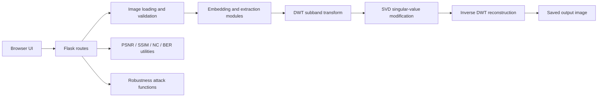

# ROBUST IMAGE WATERMARKING USING DISCRETE WAVELET TRANSFORM AND SINGULAR VALUE DECOMPOSITION

## Academic Project Report

**Student:** [Student name]  
**Student ID:** [Student ID]  
**Department:** [Department]  
**Institution:** [Institution name]  
**Supervisor:** [Supervisor name]  
**Submission date:** [Date]

> Replace the bracketed institutional details before submission. This report describes the code currently in this repository. It does not claim unmeasured robustness, perfect extraction, cryptographic security, or production readiness.

## Abstract

Digital image watermarking embeds ownership or authenticity information into image data so that it can later be detected or recovered. This project implements a web-based grayscale watermarking prototype using the Discrete Wavelet Transform (DWT) and Singular Value Decomposition (SVD). A Flask application accepts a cover image and watermark, transforms the cover into wavelet subbands, modifies singular values in a selected subband, and reconstructs an output image. A non-blind extraction path compares singular values from the watermarked image with those from the original cover image. The project also contains functions for common image-processing attacks and utilities for image-quality and watermark-comparison metrics.

The current implementation is intentionally described with its limitations. It applies a single-level DWT even though a decomposition-level setting is exposed. The watermark is flattened and sampled to the length of the singular-value vector; consequently, extraction produces a vector and does not reconstruct the uploaded watermark's two-dimensional geometry. Without a reference watermark, the extraction path's displayed NC/BER values are not valid recovery metrics. The robustness API also requires additional integration and validation before it can be used to support conclusions about attack resistance. The tests pass their present assertions, but those assertions do not establish research-grade watermark recovery or robustness.

**Keywords:** digital watermarking, DWT, SVD, image processing, non-blind extraction, PSNR, SSIM

## 1. Introduction

Digital images are copied, shared, edited, and recompressed with little friction. A watermark is additional information embedded in a host image to support tasks such as ownership identification, content tracing, or integrity workflows. A useful watermarking method aims to balance two competing properties: the embedded signal should not visibly damage the cover image, and it should remain detectable after expected image transformations.

Transform-domain methods modify image coefficients rather than directly changing individual spatial pixels. The DWT separates an image into frequency-oriented subbands. SVD represents a matrix through orthogonal singular vectors and non-negative singular values. Combining these tools provides a convenient experimental framework for studying image quality and watermark changes under different conditions.

This project provides an educational implementation and browser interface. It should not be treated as an evaluated copyright-protection product: attack resistance depends on a complete, reproducible algorithm and properly measured experiments, which remain further work for this codebase.

### 1.1 Problem statement

The project investigates how to embed a grayscale watermark into a cover image using wavelet and singular-value operations, then recover watermark information with the original cover image as side information. The practical questions are whether the image can be reconstructed with limited visual distortion and how image transformations affect recovery.

### 1.2 Aim

To implement and document a DWT-SVD-based grayscale image watermarking prototype with a Flask interface and basic quality/attack evaluation utilities.

### 1.3 Objectives

- Convert uploaded cover and watermark images to grayscale.
- Transform the cover image with a 2D DWT and select a subband.
- Modify the selected subband's singular values using a strength parameter.
- Reconstruct and save a watermarked image.
- Implement non-blind extraction using the original cover image.
- Provide attack operators and image/watermark metric utilities.
- Expose the workflow through Flask pages and API routes.
- Test core functions with generated arrays and document limitations.

### 1.4 Scope

The application is a single-host research prototype. It accepts PNG, JPEG, and BMP files subject to a configured request-size limit and processes them as grayscale. The extraction algorithm is non-blind. Current code uses one-level `pywt.dwt2`; the `level` parameter is recorded and displayed but does not control a multilevel decomposition. The watermark representation is reduced to a vector whose length equals the singular-value count of the selected subband.

## 2. Background

### 2.1 Digital image watermarking

A watermarking system generally consists of an embedder and a detector or extractor. The embedder combines a cover image and watermark under an algorithm and optional key. The extractor analyzes a possibly modified image and may also need the original cover, a key, or configuration metadata. A system is **blind** if it does not require the original cover during extraction; it is **non-blind** if the cover is required. This project is non-blind.

### 2.2 Discrete Wavelet Transform

A 2D DWT decomposes an image into an approximation band and detail bands. For a one-level decomposition the implementation names the returned bands LL, LH, HL, and HH. LL contains coarser approximation information, while the other bands represent directional details. Embedding in low-frequency information can survive some compression or filtering better, but may be more visually noticeable. Detail-band embedding may reduce visible impact in some cases but can be more vulnerable to processing that removes high-frequency components. These are general trade-offs, not measured guarantees for this application.

The code calls `pywt.dwt2(image, wavelet)` once. Reconstruction calls `pywt.idwt2` with the modified and unchanged bands.

### 2.3 Singular Value Decomposition

For a real matrix $A$ with dimensions $m \times n$, SVD gives:

$$
A = U \Sigma V^T
$$

where $U$ and $V$ are orthogonal (or have orthonormal columns) and $\Sigma$ contains the singular values. In this implementation, NumPy computes a reduced SVD of the selected wavelet band.

### 2.4 Related concepts

DWT and SVD are established mathematical tools used in transform-domain image processing. This report does not present a systematic literature review or claim that the present prototype improves on published algorithms. Future academic work should compare a fully specified method against peer-reviewed baselines using fixed datasets, attacks, and parameter settings.

## 3. System Design

### 3.1 Architecture



### 3.2 Main components

| Component | Responsibility |
|---|---|
| `app.py` | Flask pages, API handlers, output downloads |
| `config.py` | Upload/output folders, accepted extensions, request-size cap |
| `algorithms/dwt_transform.py` | One-level DWT decomposition and inverse reconstruction |
| `algorithms/svd_embedding.py` | Watermark vector preparation, optional deterministic permutation, SVD embedding/extraction |
| `algorithms/watermark_embedding.py` | Embed pipeline and cover-quality metrics |
| `algorithms/watermark_extraction.py` | Non-blind extraction and optional reference comparison |
| `algorithms/robustness.py` | Image attack operators and attack-loop wrapper |
| `utils/metrics.py` | PSNR, SSIM, normalized correlation, BER |
| `utils/image_utils.py` | Grayscale file loading, conversion, and output saving |
| `templates/`, `static/` | Browser pages, styles, and form JavaScript |
| `tests/` | Pytest checks using generated images |

### 3.3 Data flow

For embedding, the browser posts image files and settings to `/api/embed`. The backend decodes both images as grayscale arrays, invokes the embedding function, writes a PNG into the output folder, and returns metrics and a download URL. For extraction, `/api/extract` receives a watermarked image plus the original cover and settings. The algorithm extracts a singular-value difference vector and saves it as an output image. The robustness route dispatches attack specifications to attack functions and invokes extraction on each attacked output.

## 4. Methodology and Mathematical Formulation

### 4.1 Preprocessing

Let the grayscale cover be $I \in [0,255]^{H \times W}$ and watermark be $W_0$. The image loader converts uploaded files to grayscale. The cover is converted to floating-point values for processing. The watermark is flattened, then sampled at evenly spaced indices if its element count differs from the singular-value vector length. This is a simple capacity reduction, not a block-SVD watermark tiling scheme; spatial watermark structure is therefore not preserved exactly.

### 4.2 DWT decomposition

The code obtains a single-level decomposition:

$$
(I_{LL}, I_{LH}, I_{HL}, I_{HH}) = \operatorname{DWT2}(I)
$$

The selected band $A$ is chosen from LL, LH, HL, or HH. The function accepts a wavelet name, with Haar as the default.

### 4.3 SVD-domain embedding

The selected band is decomposed:

$$
A = U \operatorname{diag}(s) V^T
$$

The preprocessed watermark vector is normalized to $w_i \in [0,1]$. Optional key-dependent scrambling applies a deterministic permutation $\pi$ to the vector. The modified singular values are:

$$
s_i' = s_i + \alpha w_{\pi(i)}
$$

where $\alpha$ is the embedding-strength parameter. Without a key, $\pi$ is the identity. The modified band is reconstructed as:

$$
A' = U \operatorname{diag}(s') V^T
$$

The implementation adds the normalized vector to the diagonal singular-value matrix; it does not add a 2D image directly to a 1D singular-value array.

### 4.4 Inverse transform

The code replaces the selected wavelet band by $A'$ and applies the inverse DWT:

$$
I_w = \operatorname{IDWT2}(I_{LL}', I_{LH}', I_{HL}', I_{HH}')
$$

The reconstructed samples are clipped to the 8-bit range and converted to unsigned 8-bit values before saving.

### 4.5 Extraction

Given watermarked image $I_w$ and original cover $I$, the implementation decomposes both using the same wavelet and selects the corresponding bands. It computes their singular values $s_w$ and $s$ and estimates:

$$
\hat{w}_i = \operatorname{clip}\left(\frac{s_{w,i} - s_i}{\alpha}, 0, 1\right)
$$

If a key is used, the implementation regenerates and reverses the deterministic permutation. Extraction requires the original cover and matching embedding parameters. The current return value is a 1D singular-value-length vector; it is not reshaped using stored watermark dimensions. As a result, this implementation does not support a meaningful claim of exact reconstruction of the uploaded 2D watermark.

### 4.6 Key handling

The key is hashed with SHA-256 and the first eight digest bytes initialize NumPy's `default_rng`, which makes the permutation reproducible. This generator is designed for numerical pseudorandom tasks, not cryptographic security. The key is not a substitute for authenticated encryption or a cryptographic watermark protocol. The application should not be used to protect sensitive secrets.

## 5. Evaluation Metrics

### 5.1 PSNR

For cover image $I$ and watermarked image $I_w$ with mean squared error $\operatorname{MSE}$, the implementation uses an 8-bit maximum value:

$$
\operatorname{PSNR} = 10 \log_{10}\left(\frac{255^2}{\operatorname{MSE}}\right)
$$

When MSE is zero, the mathematical result is infinite. PSNR should be calculated on aligned arrays of the same dimensions and range.

### 5.2 SSIM

SSIM is calculated using scikit-image's `structural_similarity` with a data range derived from the input arrays. It compares local luminance, contrast, and structure. It should be interpreted together with visual inspection and other measures.

### 5.3 NC and BER

The utility named NC computes a mean-centered, normalized dot product:

$$
\operatorname{NC}(x,y) = \frac{\sum_i (x_i-\bar{x})(y_i-\bar{y})}{\sqrt{\sum_i(x_i-\bar{x})^2}\sqrt{\sum_i(y_i-\bar{y})^2}}
$$

This is Pearson-style correlation and assumes corresponding samples. BER thresholds normalized values at 0.5 and measures the fraction of unequal bits. Both metrics require correctly aligned original and extracted watermark samples. If no original watermark is given, the current extraction code compares the recovered vector against itself and assigns BER zero; those values are not valid recovery measurements and must not be reported as experiment outcomes.

### 5.4 Execution time

Embedding and extraction use `time.perf_counter()` and report elapsed milliseconds. Reproducible performance comparisons should record machine, Python and dependency versions, image dimensions, warm-up policy, and repetition statistics. No such benchmark campaign is included in this repository.

## 6. Attack Operators

The robustness module contains functions for:

| Attack | Current transformation |
|---|---|
| JPEG | Encode and decode through OpenCV at a selected quality setting |
| Gaussian noise | Add random normal noise and clip to 8-bit range |
| Salt-and-pepper | Replace selected pixels with 0 or 255; current coordinate seed is fixed |
| Gaussian blur | Apply a Gaussian kernel, adjusting even kernel sizes upward to odd |
| Resize | Resize by a scale factor and restore the original dimensions |
| Brightness | Add a scalar pixel offset and clip |
| Contrast | Multiply pixel values and clip |
| Crop | Take a centered crop and resize it to the original dimensions |

These functions describe operations implemented in code. The project has not established that the watermark survives them. Gaussian noise uses an unseeded global random draw, and crop-and-resize is not a synchronization/recovery method; it changes image content and alignment. Attack results should be collected only after the robustness endpoint serializes results correctly and the extraction comparison uses a valid reference watermark.

## 7. Implementation and User Interface

The web application uses Flask for routing, Pillow for grayscale file decoding/saving, NumPy and PyWavelets for numerical processing, OpenCV for attacks, and scikit-image for SSIM. Bootstrap is loaded from a CDN for layout and Chart.js is used by the results page. The pages include Home, Embed, Extract, Robustness, and Results.

The embedding form connects to `/api/embed`; the extraction form connects to `/api/extract`. The current UI does not expose reference-watermark upload for extraction, despite the backend supporting an optional field. The robustness endpoint returns attack image arrays in its result objects, which Flask's standard JSON encoder cannot serialize as-is. Therefore the robustness UI and result charts must not be described as fully operational without a code change and successful endpoint test. The results page currently depends on session data and does not persist a full experiment report.

## 8. Testing and Verification

### 8.1 Test suite

Tests use generated NumPy arrays rather than external image datasets. They cover DWT reconstruction shape, SVD reconstruction shape, embedding output shape/basic image-quality thresholds, extraction call behavior, metric computation, robustness result structure, and basic Flask responses.

The latest recorded command was:

```text
python -m pytest -q
8 passed in 4.13s
```

This is evidence that the current assertions pass. It is not evidence that real watermark extraction works at a stated accuracy: the extraction test does not supply `original_watermark`, and in that case the code sets NC by comparing a vector with itself and BER to zero. The test should be strengthened before citing recovery accuracy in an academic evaluation.

### 8.2 Manual application check

The development-server log supplied in the workspace shows successful page requests and successful `/api/embed` and output-download requests for at least one local image. The same log includes failed embedding requests that returned HTTP 400, with no request details to determine their causes. This supports basic application reachability and at least one successful embedding/download workflow, but it does not provide a reproducible dataset, settings, or quality measurements.

### 8.3 Results reporting

No quantitative robustness results are stated in this report. To produce valid result tables, run a corrected end-to-end pipeline using a reference watermark, document the exact images/settings, record raw metrics for each attack parameter, repeat random attacks with controlled seeds, and preserve the output files. Report failures as well as successes.

## 9. Security, Reliability, and Limitations

1. **Non-blind extraction:** the original cover image and matching algorithm settings are required.
2. **Reduced watermark representation:** arbitrary watermark images are flattened and sampled to a singular-value-length vector; the original 2D layout is not retained.
3. **Single-level transform:** the decomposition-level form value is not used by `dwt2`/`idwt2`.
4. **Metric correctness:** NC/BER are not meaningful without a correctly resized and aligned reference watermark; the no-reference extraction branch currently returns misleading self-correlation and zero BER.
5. **Robustness integration:** attack image arrays are included in JSON output and are not JSON serializable by default. The endpoint needs to return metadata and/or saved image URLs instead.
6. **Parameter validation:** numerical fields, attack names, and attack ranges need stricter validation.
7. **Key security:** deterministic NumPy pseudorandom scrambling is not cryptographic. The Flask session key is hard-coded and must be replaced before deployment.
8. **Development configuration:** Flask debug mode is enabled in the entry point. Debug mode must not be used on a public server.
9. **Error handling:** API handlers return exception text to clients, which is convenient during development but can reveal implementation details.
10. **No controlled benchmark:** no validated dataset, repeated trials, attack curves, or independently verified quality table is included.
11. **Image dimensions and formats:** images are converted to grayscale and outputs are 8-bit; color channels and metadata are not retained.
12. **Watermarking security:** there is no cryptographic authentication, tamper-proof proof-of-ownership protocol, or legal guarantee.

## 10. Future Work

- Define and implement a watermark representation that retains geometry, such as block-based SVD or a documented coefficient map.
- Store watermark dimensions and data-type/configuration metadata needed for extraction.
- Add genuinely reference-based NC and BER evaluation to the extraction UI and test pipeline.
- Correct key permutation handling and use a well-reviewed cryptographic construction if confidentiality/authentication is a requirement.
- Implement multi-level DWT consistently in embedding and extraction, or remove the unused level control.
- Fix robustness output serialization, save attacked outputs safely, and return structured JSON metadata.
- Add parameter validation, content-based file checks, random application secret configuration, generic API errors, and production deployment settings.
- Add deterministic random seeds and repeated trials for stochastic attacks.
- Test JPEG compression, Gaussian noise, blur, resize, brightness, contrast, and crop with recorded NC/BER curves and image-quality measures.
- Compare against a simple baseline and report results with dataset provenance and limitations.
- Improve the interface with image previews, progress/loading states, downloadable CSV reports, and visually inspectable extraction output.

## 11. Conclusion

This project provides a Flask-based educational prototype for exploring DWT and SVD operations in image watermarking. It demonstrates a transform-domain embedding path, a non-blind singular-value-difference extraction approach, image-quality metric utilities, and a set of common attack operators. The current implementation is not yet sufficient to support claims of reliable watermark recovery or attack resistance: the watermark is reduced to a vector, no-reference metrics are misleading, and robustness results require endpoint and evaluation fixes. These limitations are explicit targets for continued development. A defensible final experimental conclusion should be written only after reference-based recovery tests and reproducible attack measurements have been completed.

## References

1. Mallat, S. (1989). A theory for multiresolution signal decomposition: The wavelet representation. *IEEE Transactions on Pattern Analysis and Machine Intelligence*, 11(7), 674–693.
2. Golub, G. H., & Reinsch, C. (1970). Singular value decomposition and least squares solutions. *Numerische Mathematik*, 14, 403–420.
3. Wang, Z., Bovik, A. C., Sheikh, H. R., & Simoncelli, E. P. (2004). Image quality assessment: From error visibility to structural similarity. *IEEE Transactions on Image Processing*, 13(4), 600–612.
4. Gonzalez, R. C., & Woods, R. E. (2018). *Digital Image Processing* (4th ed.). Pearson.
5. PyWavelets documentation. *2D Discrete Wavelet Transform*. https://pywavelets.readthedocs.io/
6. NumPy documentation. *Singular Value Decomposition*. https://numpy.org/doc/
7. scikit-image documentation. *Structural Similarity Index*. https://scikit-image.org/docs/

## Appendix A: Reproduction Commands

Windows PowerShell:

```powershell
python -m venv .venv
.\.venv\Scripts\Activate.ps1
python -m pip install -r requirements.txt
python -m pytest -q
python app.py
```

Open `http://127.0.0.1:5000/` after starting the local development server.
