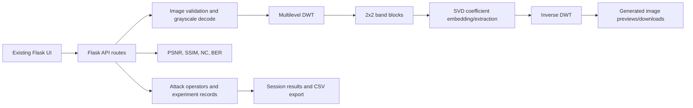

# ROBUST IMAGE WATERMARKING USING DISCRETE WAVELET TRANSFORM AND SINGULAR VALUE DECOMPOSITION

## Academic Project Report

**Student:** [Student name]  
**Student ID:** [Student ID]  
**Department:** [Department]  
**Institution:** [Institution name]  
**Supervisor:** [Supervisor name]  
**Submission date:** [Date]

> Replace the bracketed institutional details before submission. Results in this report are from one deterministic synthetic demonstration. They are not a dataset benchmark or a claim of general robustness.

## Abstract

This project implements a grayscale image watermarking prototype using a multilevel Discrete Wavelet Transform (DWT) and Singular Value Decomposition (SVD). Each normalized watermark pixel modifies the largest singular value of a separate 2×2 block in a selected wavelet subband. The Flask application supports embedding, non-blind reference-based extraction, common image attacks, image-quality and watermark metrics, previews, charts, and CSV export.

The current method retains the source watermark dimensions as metadata and automatically fits oversized payloads to available DWT capacity. If fitting is needed, watermark detail is lost and cannot be restored by extraction. Extraction requires the exact original cover and reference watermark, together with matching algorithm settings. The tests verify clean recovery on generated data, but the block grid has no synchronization or error correction. Example attack measurements show varying recovery and severe degradation under some transformations. Those results illustrate this configuration only; they do not establish general attack resistance.

**Keywords:** digital watermarking, DWT, SVD, non-blind extraction, PSNR, SSIM, normalized correlation, BER

## 1. Introduction

Digital image watermarking inserts auxiliary information into a host image. Transform-domain approaches alter coefficients representing spatial frequency information rather than directly replacing pixels. This project combines a wavelet transform, which separates approximation and directional detail bands, with SVD, which represents a matrix through orthogonal singular vectors and singular values.

The application is an educational experiment tool. It is not a production ownership, authentication, cryptographic, or legal-proof system. Its purpose is to make the embedding, extraction, and measurement steps explicit and reproducible for a controlled demonstration.

### 1.1 Aim and objectives

The aim is to implement and evaluate a DWT-SVD grayscale watermarking prototype. Objectives are to:

- embed watermark samples across the available bands, fitting oversized payloads to capacity;
- recover the watermark using the original cover and matching configuration;
- calculate image quality and reference-based watermark metrics;
- execute selected image attacks and record actual extraction results;
- expose the workflow through the existing Flask interface; and
- test expected behavior, including invalid inputs and failed comparisons.

### 1.2 Scope

Inputs are grayscale-converted PNG, JPEG, BMP, WEBP, TIFF, or GIF images; animated GIF input uses its first frame. The request limit is 16 MiB and decoded image limit is 16 megapixels. An oversized watermark is automatically reduced to the selected cover's finite coefficient capacity. Extraction is non-blind. It requires the exact original cover, reference watermark, wavelet, decomposition level, subband, embedding strength, watermark type, and optional key used during embedding.

## 2. Background

### 2.1 Discrete Wavelet Transform

A \(J\)-level 2D DWT represents an image by an approximation band at level \(J\) and directional detail bands at each level. This implementation lets the user select LL, LH, HL, or HH at the chosen level. The decomposition uses PyWavelets' symmetric boundary mode and reconstruction crops the result to the source dimensions. The wavelet and level must match during embedding and extraction.

### 2.2 Singular Value Decomposition

For a real matrix \(A\in\mathbb{R}^{m\times n}\), SVD gives:

$$
A=U\Sigma V^T,
$$

where \(U\) and \(V\) are orthogonal (or have orthonormal columns) and \(\Sigma\) contains non-negative singular values. The application applies reduced SVD independently to small blocks of the selected DWT band.

## 3. System Design

### 3.1 Architecture



### 3.2 Main modules

| File or folder | Responsibility |
|---|---|
| `app.py` | Flask pages, API routes, generated image previews/downloads, CSV export |
| `config.py` | Upload/output locations, supported formats, request-size limit |
| `algorithms/dwt_transform.py` | Multilevel DWT decomposition and inverse reconstruction |
| `algorithms/svd_embedding.py` | Block-SVD embedding/extraction, payload validation, key permutation |
| `algorithms/watermark_embedding.py` | Watermark embedding pipeline and cover-quality calculation |
| `algorithms/watermark_extraction.py` | Non-blind extraction and reference-based comparison |
| `algorithms/robustness.py` | Attack operators and per-attack extraction experiments |
| `utils/metrics.py` | Validated PSNR, SSIM, normalized correlation, BER |
| `utils/image_utils.py` | Image decoding, grayscale conversion, and saving |
| `templates/`, `static/` | Browser pages, styling, preview rendering, charts |
| `tests/` | Algorithm, metric, robustness, and Flask tests |

## 4. Embedding and Extraction Method

### 4.1 Preparation

Let cover \(I\in[0,255]^{H\times W}\) and watermark \(W\in[0,255]^{H_W\times W_W}\) be grayscale images. Grayscale watermark samples are normalized as \(w_i=W_i/255\). In binary mode, the watermark is thresholded at its mean and converted to zero/one values. There is no vector truncation, sample repetition, or silent watermark resize.

### 4.2 DWT band and capacity

The cover is decomposed to the selected level \(J\), giving one selected band \(A\in\mathbb{R}^{r\times c}\) or, when **ALL** is selected, LL, LH, HL, and HH at that level. Each chosen band is partitioned from the top-left into non-overlapping 2×2 blocks. For one band, the number of usable blocks is:

$$
C=\left\lfloor\frac{r}{2}\right\rfloor
  \left\lfloor\frac{c}{2}\right\rfloor.
$$

For **ALL**, the capacity is the sum of the block counts across the four bands. If a single-band selection is too small, the application automatically switches to **ALL**. If the source watermark still exceeds the combined capacity, it is downscaled with area interpolation to fit. Original dimensions are retained as metadata, but details discarded during downscaling are irrecoverable. Incomplete rows or columns at each band boundary remain unchanged.

### 4.3 Block-SVD embedding

For watermark sample \(w_i\), let its corresponding block be:

$$
B_i=U_i
\begin{bmatrix}
\sigma_{i,1}&0\\
0&\sigma_{i,2}
\end{bmatrix}V_i^T,
\qquad \sigma_{i,1}\geq\sigma_{i,2}\geq0.
$$

Embedding strength is \(0<\alpha\leq0.3\). The modified singular values are:

$$
\sigma'_{i,1}=\sigma_{i,1}+192\alpha w_{\pi(i)},\qquad
\sigma'_{i,2}=\sigma_{i,2}.
$$

The block is reconstructed as:

$$
B'_i=U_i
\begin{bmatrix}
\sigma'_{i,1}&0\\
0&\sigma'_{i,2}
\end{bmatrix}V_i^T.
$$

If there is no key, \(\pi\) is the identity. If a key is given, it seeds a deterministic NumPy permutation using a SHA-256 digest. In **ALL** mode, the globally scrambled watermark vector is split across LL, LH, HL, and HH in that order. The selected bands are reconstructed with the modified blocks, then an inverse DWT reconstructs and clips the 8-bit watermarked output.

### 4.4 Non-blind extraction

Extraction decomposes the watermarked image and original cover with matching settings and follows the same band and block ordering. It applies the same capacity fit to the reference watermark. In **ALL** mode, extracted samples from LL, LH, HL, and HH are concatenated in that order before reversing the global key permutation. With \(N\) equal to the fitted sample count:

$$
\hat w_{\pi(i)}=
\operatorname{clip}\left(
\frac{\sigma^{(w)}_{i,1}-\sigma^{(c)}_{i,1}}{192\alpha},
0,1
\right), \qquad 0\leq i<N.
$$

The permutation is inverted when a key was supplied, and the resulting vector is reshaped to the fitted watermark dimensions for comparison with the fitted reference. If resizing was required, the extracted image is enlarged to the reference's original dimensions for display; enlargement does not restore discarded details. Extraction without the original cover or reference watermark is rejected.

### 4.5 Limitations of the method

The coefficient difference is affected by inverse-DWT reconstruction, 8-bit quantization, clipping, image formats, and attacks. More strength improves the coefficient signal relative to quantization but may increase visible distortion. Each watermark pixel consumes one block, so capacity is limited. The fixed row-major block grid has no synchronization mechanism or error correction; cropping and geometric rescaling can misalign every subsequent block. Key-based scrambling is reproducible obfuscation, not encryption.

## 5. Evaluation Method

### 5.1 Image quality

PSNR between aligned 8-bit grayscale images \(X\) and \(Y\) is:

$$
\operatorname{MSE}(X,Y)=\frac{1}{HW}\sum_{i=1}^{H}\sum_{j=1}^{W}(X_{ij}-Y_{ij})^2,
\qquad
\operatorname{PSNR}=10\log_{10}\frac{255^2}{\operatorname{MSE}}.
$$

Identical images have infinite PSNR. SSIM uses scikit-image with `data_range=255`. The embedding report compares the original cover with the actual saved 8-bit watermarked image. Attack PSNR/SSIM compare the watermarked image with its attacked version.

### 5.2 Watermark recovery

The conventional normalized correlation is:

$$
\operatorname{NC}(x,y)=
\frac{\sum_i x_i y_i}{\sqrt{\sum_i x_i^2}\sqrt{\sum_i y_i^2}}.
$$

The inputs are corresponding normalized reference and extracted samples in \([0,1]\). For the zero-vector edge case, NC is defined as 1 when both arrays are zero and 0 when exactly one is zero. This allows a valid black watermark to be evaluated without treating a zero extraction of a nonzero reference as successful. BER thresholds both arrays at 0.5:

$$
\operatorname{BER}(x,y)=
\frac{1}{N}\sum_{i=1}^N
\mathbf{1}\big[(x_i>0.5)\neq(y_i>0.5)\big].
$$

The metrics reject unequal shapes, invalid ranges, empty arrays, and non-finite values; they do not truncate or align arrays silently. No-reference extraction is not allowed to substitute self-correlation or zero BER.

### 5.3 Attack experiments

For each selected attack configuration, the program generates an attacked image, attempts the actual non-blind extraction against the original cover and reference watermark, measures PSNR/SSIM against the original watermarked image, and records extraction NC, BER, and elapsed time. A result row is marked `measured` when the comparison is defined. If extraction or comparison is impossible, the row is `extraction_failed` and NC/BER are null; no recovery score is fabricated.

Available operators are JPEG compression, seeded Gaussian noise, seeded salt-and-pepper noise, Gaussian blur, resize-and-restore, brightness shift, contrast scaling, and center crop followed by resize. Repeated runs of stochastic attacks should use controlled seeds. Extraction time is a single-run wall-clock measurement and is not a hardware-independent performance benchmark.

## 6. Measured Synthetic Demonstration

### 6.1 Setup

The measurements below were generated by running the implemented embedder, extractor, and attack runner once on **2026-10-11**:

- Cover: NumPy-generated random grayscale image, 128×128, seed `20261011`.
- Watermark: 32×32 binary checkerboard, alternating 0 and 255.
- Settings: Haar, level 1, LL, \(\alpha=0.05\), key `demo-key`.
- Attacks: one value per listed configuration, with NumPy seed 0 for random noise.
- Attack PSNR/SSIM are measured against the un-attacked watermarked image.

The 128×128 cover gives a level-1 Haar LL band of 64×64 and capacity \(32\times32=1024\), exactly the checkerboard's 1024 samples.

### 6.2 Clean embedding and extraction

| Measurement | Observed value |
|---|---:|
| Cover vs watermarked PSNR | 45.2889 dB |
| Cover vs watermarked SSIM | 0.999876 |
| Clean extraction NC | 0.996311 |
| Clean extraction BER | 0.000000 |
| Embedding time | 8.54 ms |
| Clean extraction time | 7.62 ms |

Clean extraction here is a verified comparison against the actual checkerboard reference. These values apply only to this generated image, configuration, and single execution.

### 6.3 Attack results

| Attack and setting | Status | PSNR (dB) | SSIM | NC | BER | Extraction time (ms) |
|---|---|---:|---:|---:|---:|---:|
| JPEG quality 90 | measured | 36.3527 | 0.998572 | 0.978476 | 0.021484 | 7.25 |
| JPEG quality 70 | measured | 26.9879 | 0.987698 | 0.868492 | 0.177734 | 7.48 |
| JPEG quality 40 | measured | 20.9266 | 0.951230 | 0.694881 | 0.333984 | 7.30 |
| Gaussian noise variance 25, seed 0 | measured | 34.2121 | 0.997701 | 0.792011 | 0.249023 | 8.88 |
| Salt-and-pepper density 0.01, seed 0 | measured | 25.4151 | 0.983391 | 0.913131 | 0.068359 | 8.89 |
| Gaussian blur kernel 5 | measured | 11.7680 | 0.243889 | 0.502145 | 0.446289 | 7.62 |
| Resize scale 0.75, restore size | measured | 13.0322 | 0.490197 | 0.513704 | 0.439453 | 9.67 |
| Brightness delta +20 | measured | 22.3693 | 0.989164 | 0.707107 | 0.500000 | 7.78 |
| Contrast factor 1.2 | measured | 20.4487 | 0.976494 | 0.707107 | 0.500000 | 7.46 |
| Center crop ratio 0.8, restore size | measured | 9.1693 | 0.005808 | 0.493239 | 0.497070 | 10.19 |

These results show that quality scores alone do not imply watermark recovery: for example, brightness and contrast retain relatively high SSIM while yielding BER 0.5. The one-run synthetic table is illustrative, not a statistical study, and the `measured` label only means the extraction comparison was computable—not that the watermark passed a success threshold.

**Environment:** Python 3.14.7, Flask 3.1.3, NumPy 2.5.3, OpenCV 5.0.0, PyWavelets 1.8.0, Pillow 12.3.0, SciPy 1.18.1, scikit-image 0.26.0. Timing varies with machine and system load.

## 7. Testing and Verification

The automated tests use generated arrays, not a real-world image dataset. They verify:

- DWT reconstruction, including an odd image shape and multilevel decomposition;
- block SVD output, automatic capacity fitting, and extraction;
- clean non-blind recovery with the true reference watermark;
- that the deterministic lossy recovery case does not incorrectly return perfect NC or zero BER;
- extraction rejection when required reference data is missing;
- metric shape, range, and undefined-comparison validation;
- actual attack-and-extract result structure and no fabricated scores on failure; and
- basic Flask pages, missing-input responses, and application secret/debug settings.

Run:

```powershell
python -m pytest -q
```

Latest observed result after the implementation changes: **25 passed**. This validates the present assertions, not broad generalization or resilience claims.

## 8. Security and Deployment Notes

The application uses `FLASK_SECRET_KEY` if configured and otherwise creates a random process-local secret; sessions will be lost after restart when using the fallback. Debug mode is off unless `FLASK_DEBUG` is explicitly enabled. API handlers provide user-facing validation messages and log unexpected processing errors rather than returning internal exception text.

This prototype is intended for local use. Before deployment, use a production WSGI server, stable managed secret configuration, storage retention controls, request throttling, and a deployment-specific security review. The optional key does not encrypt or authenticate image data.

## 9. Conclusion and Future Work

The updated project provides a dimension-preserving block-based DWT-SVD embedder, reference-required non-blind extraction, strict metric inputs, and real attack-and-extract experiments. It demonstrates high clean recovery for one generated example, while the included attack table shows degradation for several transformations. This is evidence only about the tested synthetic inputs and settings.

Future work should evaluate a representative image corpus, repeat experiments across images and attack seeds, report distributions or confidence intervals, compare with appropriate baselines, add synchronization and error correction, and study capacity/visibility trade-offs. Robustness claims should be based on those controlled evaluations rather than one demonstration.

## References

1. Mallat, S. (1989). A theory for multiresolution signal decomposition: The wavelet representation. *IEEE Transactions on Pattern Analysis and Machine Intelligence*, 11(7), 674–693.
2. Golub, G. H., & Reinsch, C. (1970). Singular value decomposition and least squares solutions. *Numerische Mathematik*, 14, 403–420.
3. Wang, Z., Bovik, A. C., Sheikh, H. R., & Simoncelli, E. P. (2004). Image quality assessment: From error visibility to structural similarity. *IEEE Transactions on Image Processing*, 13(4), 600–612.
4. Gonzalez, R. C., & Woods, R. E. (2018). *Digital Image Processing* (4th ed.). Pearson.
5. PyWavelets documentation. *2D Discrete Wavelet Transform*. https://pywavelets.readthedocs.io/
6. NumPy documentation. *Singular Value Decomposition*. https://numpy.org/doc/
7. scikit-image documentation. *Structural Similarity Index*. https://scikit-image.org/docs/
